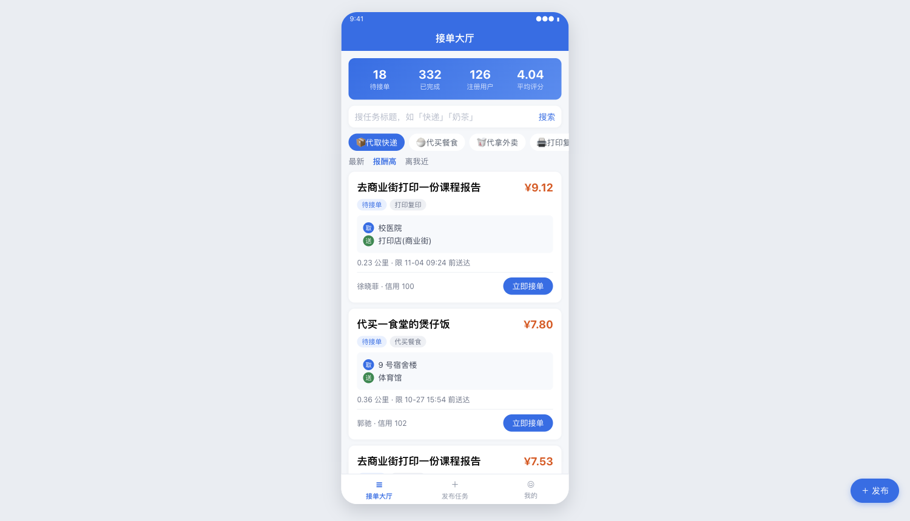
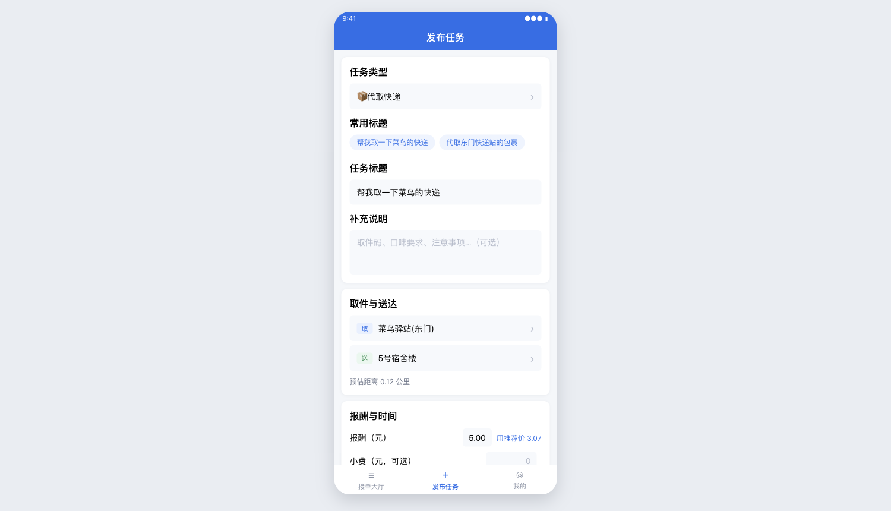
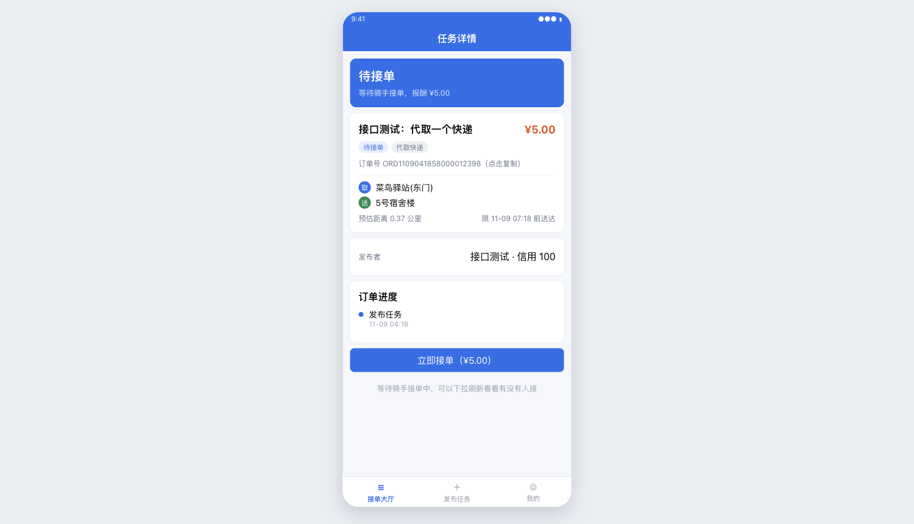
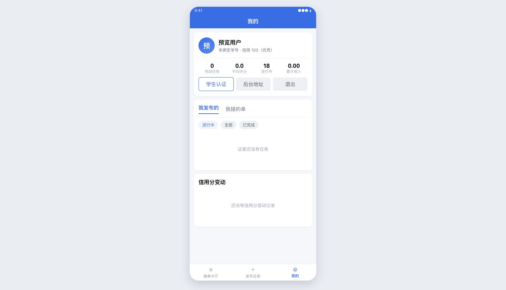
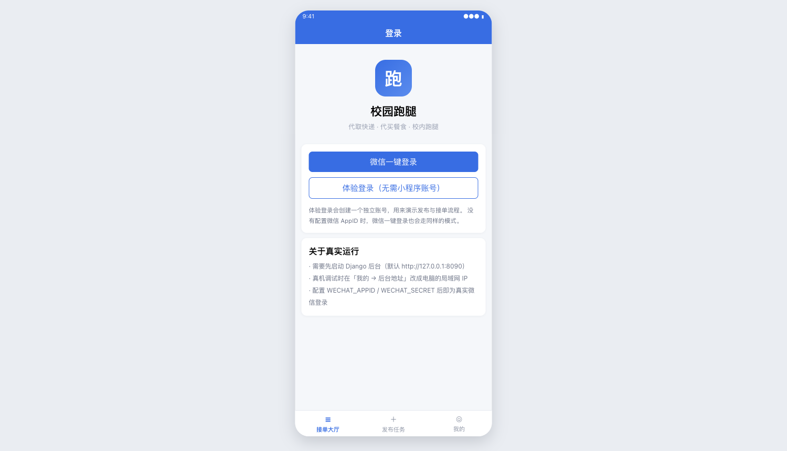
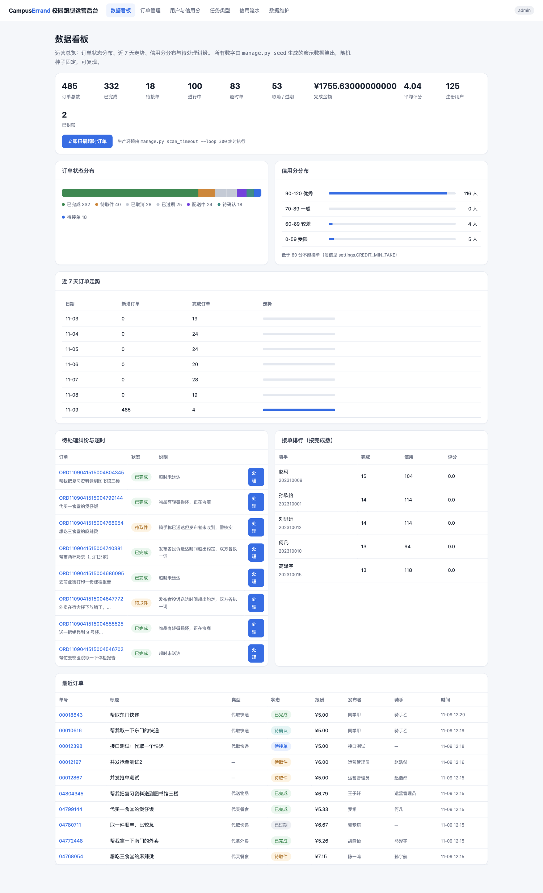
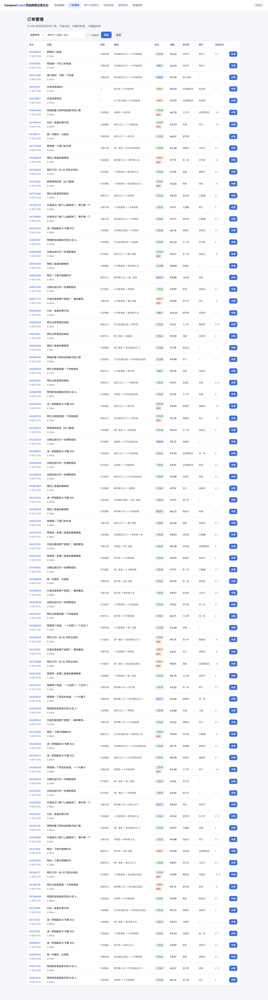
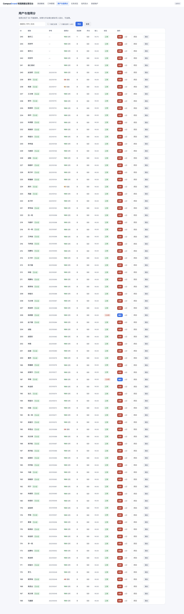

# 026 基于微信小程序与 Django 的校园跑腿系统-设计展示

> **代码有偿获取 可接受定制 微信联系方式: csbysj2020 或 ACE2487，备注(BS)**

> **完整源码与全套文档 · 在线自助获取 >>> [https://mbd.pub/o/bread/YZaWlZ5saw==](https://mbd.pub/o/bread/YZaWlZ5saw==)**

> **成品页（功能介绍 / 更多选题）>>> [https://bishe.suilang.net/products/campus-errand-mini](https://bishe.suilang.net/products/campus-errand-mini)**

> 

> 

## 视频

> **点击查看 >>> [https://www.bilibili.com/video/BV1ZBW46eEYo/](https://www.bilibili.com/video/BV1ZBW46eEYo/)**

## 项目简介

把校园跑腿从「群里喊一声」升级成有状态、有约束、有信用的交易：订单走显式状态机（7 个状态、非法流转一律拒绝），抢单在并发下保证只有一人成功，信用分每一次变动都留流水可查。微信小程序 5 个页面 + Django 运营后台 5 个页面 + 16 个接口。实测 10 个线程同时抢一个任务：1 人成功、9 人收到「手慢了」提示、0 个系统异常。

校园里的跑腿需求是真实且高频的：取快递、带饭、打印文档、送钥匙。

目前这些需求大多在微信群或 QQ 群里靠「发消息 + 有人回复」完成，这种方式有三个绕不开的问题。

第一是没有状态——一条消息发出去之后，是「还没人接」「已经接单在路上」还是「已经送到」，群里看不出来，只能靠反复追问。

本仓库为**设计展示**：包含项目说明、技术架构、实验结果与运行截图；完整源码、任务书、开题报告、毕业论文与使用说明可通过上方链接自助获取，成品页可查看更多选题，也可联系微信咨询定制。

## 功能特性

1. 订单状态机：7 个状态（待接单/待取件/配送中/待确认/已完成/已取消/已过期）+ 一张显式迁移表，所有变更走同一个入口，非法迁移直接拒绝。实测 10 项操作中 7 类非法操作全部被拦截

2. 抢单并发安全：事务 + select_for_update 行锁 + 锁内状态复检 + 退避重试。10 线程抢同一任务的实测结果：1 人成功、9 人「手慢了」、0 个系统异常（并发冲突被从系统报错降级为业务提示）

3. 信用分可追溯：按时完成 +2、好评 +1、差评 −3、接单后放弃 −5、超时未送达 −4、管理员判责 −10，每笔变动都写流水（含原因与关联订单），低于 60 分不能接单

4. 权限不在前端算：接口返回 can_accept / can_pick / can_deliver / can_confirm 等字段由后端根据用户与状态算出，小程序只负责显隐按钮，前端被绕过后端仍安全

5. 计费规则可配置：推荐报酬 = 起步价 + 每公里加价 × 距离（Haversine 计算），规则在后台维护、改完立刻生效，用户也可手动改价

6. 超时处理三件套：超时无人接自动过期、已接单超时标记并扣分、接单 30 分钟未取件自动释放回任务池（可挂 crontab 定时跑，也能在后台一键触发）

7. 运营后台：数据看板（状态分布、近 7 天走势、信用分区间、接单排行、待处理纠纷）、订单管理、订单详情与纠纷处理、用户与信用管理、任务类型维护

8. 小程序端免构建：原生开发，微信开发者工具导入即用；没配 AppID 时可用「体验登录」跑通全流程，配了 AppID 就是真实微信登录

9. 结算用 F() 表达式原子累加，避免并发丢更新；平台抽成 5% 精确到分（5.00 元订单骑手实收 4.75 元）

## 技术架构

| 项目 | 说明 |
| --- | --- |
| 编程语言 | Python 3.8 |
| 后端框架 | Django 4.2（接口 + 运营后台） |
| 小程序端 | 原生微信小程序（5 个页面，无 npm 构建步骤） |
| 数据库 | SQLite（免安装、单文件；换 MySQL 只需改配置） |
| 接口鉴权 | 登录发 token，请求带 X-Token 头（小程序无 cookie） |
| 并发控制 | 事务 + select_for_update + 锁内复检 + 退避重试 |
| 距离计算 | Haversine 公式（不引入 GIS 依赖） |
| 数据规模 | 演示数据：120 用户 / 6 种任务类型 / 480 订单 / 255 评价 / 597 条信用流水 |
| 部署形态 | 本地启动脚本，端口 8090 |

## 目录结构

以下为完整交付版的结构（本仓库仅作设计展示）：

```
campus-errand-mini/
├── 任务书/
│   └── 毕业设计任务书.docx
├── 开题报告/
│   └── 毕业设计开题报告.docx
├── 最终论文/
│   ├── 图/
│   │   ├── 026-01-mini-index.png
│   │   ├── 026-03-mini-detail.png
│   │   ├── 026-06-admin-dashboard.png
│   │   ├── 图3-1_系统用例图.png
│   │   ├── 图4-1_系统架构图.png
│   │   ├── 图4-2_数据库ER图.png
│   │   └── 图4-3_订单状态流转图.png
│   └── 基于微信小程序与Django的校园跑腿系统设计.docx
├── 源码/
│   ├── config/
│   │   ├── __init__.py
│   │   ├── settings.py
│   │   ├── urls.py
│   │   └── wsgi.py
│   ├── data/
│   │   └── db.sqlite3
│   ├── deploy/
│   ├── errand/
│   │   ├── management/
│   │   ├── migrations/
│   │   ├── __init__.py
│   │   ├── admin.py
│   │   ├── apps.py
│   │   ├── models.py
│   │   ├── services.py
│   │   ├── urls_admin.py
│   │   ├── urls_api.py
│   │   ├── views_admin.py
│   │   └── views_api.py
│   ├── miniprogram/
│   │   ├── components/
│   │   ├── images/
│   │   ├── pages/
│   │   ├── utils/
│   │   ├── app.js
│   │   ├── app.json
│   │   └── …
│   └── …
└── …
```

## 数据与实验结论

- 本项目定义 7 个状态（待接单 / 待取件 / 配送中 / 待确认 / 已完成 / 已取消 / 已过期）和一张显式的状态迁移表，任何一次状态变更都要先过这张表，非法迁移直接拒绝——例如「待确认」不能变成「配送中」、发布者不能确认自己发布的单、骑手不能替发布者确认收货。
- 实测 10 个并发请求抢同一个任务：1 人成功、9 人收到「手慢了」提示、0 个系统异常。
- 调试过程中还发现 SQLite 是库级写锁，并发时会抛 `database is locked`，本项目为此加了带退避的重试（3 次），把这类错误从「用户看到报错」降级为「用户无感」。
- 系统内置的扣分规则包括：接单后放弃扣 5 分、超时未送达扣 4 分、接单后 30 分钟未取件扣 3 分并自动释放回任务池、差评扣 3 分；加分规则为按时完成加 2 分、好评加 1 分。
- 管理员处理纠纷时可以取消订单并判骑手有责（扣 10 分），所有操作都在订单上留下处理说明。
- 系统用固定随机种子生成了 480 条订单、120 个用户、255 条评价、597 条信用流水的演示数据，覆盖全部状态与超时、纠纷场景。

## 交付内容

1. 完整源码（后端状态机与服务层 + 小程序端 5 页 + 运营后台 5 页）
2. 固定随机种子的演示数据生成命令（一条命令生成 480 条订单，结果可复现）
3. 并发压测脚本 tools/压测抢单.py（论文 6.2 节的数字就是跑它得到的）
4. 小程序页面预览工具 tools/小程序预览.py（把 WXML/WXSS 渲染成 HTML，无需开发者工具即可核对样式）
5. 毕业设计任务书（Word）
6. 毕业设计开题报告（Word）
7. 毕业论文（Word，七章制，含状态机设计、并发测试、非法操作测试与边界讨论）
8. 系统使用与二次开发说明（Word + md）
9. 运行截图 8 张（小程序 5 页 + 后台 3 页）+ 功能演示视频（84 秒）

## 常见问题

**为什么说「状态机」是这个项目最值得讲的部分？**

因为跑腿业务最典型的脏数据来源就是状态乱掉：骑手还没送到就被确认完成、已取消的单又被接走、发布者替骑手确认收货。系统把 7 个状态和它们的迁移关系集中成一张表，所有变更走同一个入口，入口先查表再改。好处是可验证——可以穷举所有「(当前状态, 目标状态)」组合做测试；散在各处的 if 做不到这一点。论文 6.3 节的 10 项测试就是这么来的。

**抢单并发是怎么保证安全的？**

三层：事务包住「查 + 判 + 写」；select_for_update() 把这一行锁住；在锁内重新检查一次状态——锁外检查过的状态可能已经被别人改掉，只有锁内复检才可靠。另外 SQLite 是库级写锁，并发时会抛 database is locked，这不是业务错误，所以加了退避重试（50/100/150 毫秒，共 3 次）。

**并发测试的结果是什么？**

10 个线程同时抢同一个任务，结果：1 人成功、9 人收到「手慢了，这个任务已经被接走了」、0 个系统异常。换 12 线程 × 2 轮重复测，同样每轮 1 成功、0 异常。要注意的是加锁前后的一致性其实都没问题（都只有 1 人成功），差别在于用户体验——优化前 10 个人里有 6 个会看到系统报错。

**信用分为什么要写流水表？**

只存一个当前分值，用户质询「为什么我只有 62 分」时无法回答。每次变动都写一条 CreditLog（变动值 + 原因枚举 + 关联订单 + 文字说明），用户能在「我的」页看到，管理员能在后台逐条核对。纠纷处理时这一点特别有用——判责必须给出可查的依据。

**小程序端需要 AppID 吗？**

不需要。开发者工具导入时选「测试号」即可，登录页点「体验登录」就能跑通发布、接单、完成、评价的全流程。配置 WECHAT_APPID 与 WECHAT_SECRET 后，「微信一键登录」会自动切换到真实的 jscode2session 流程。这样设计是为了让拿不到企业主体资质的同学也能把项目跑起来。

**为什么没有接微信支付？**

微信支付要求企业主体资质，学生项目通常拿不到。当前用「余额记账」模拟：确认完成时从订单金额里扣 5% 平台抽成、其余结算给骑手。论文 6.5 节把「接入支付」列为后续工作，并给出了改造步骤（下单时预授权、回调验签且幂等、确认时解冻）。

## 截图









